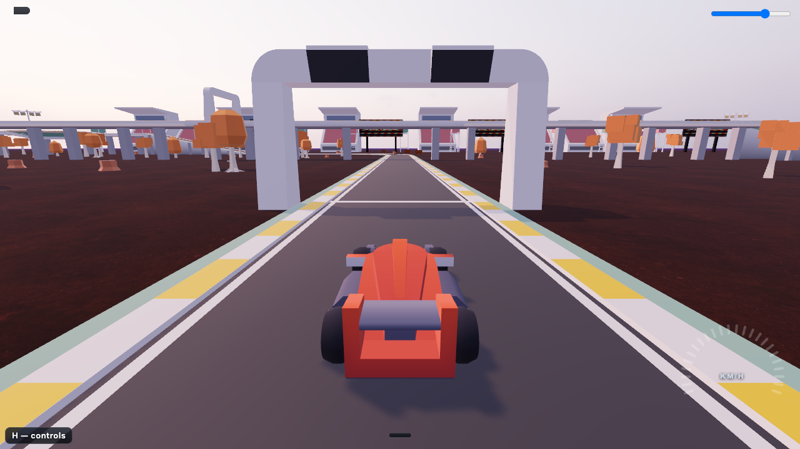

# driftline

**Play online:** https://bborbe.github.io/driftline/

Trackmania-like browser racing game: short tracks, a lap timer with checkpoints, instant respawn and a ghost of your best run.

## Features

- Grippy, drifty handling with handbrake slides and stable landings after jumps
- Campaign, style and test tracks, the campaign and style tracks with author / gold / silver / bronze medals
- Checkpoints with split deltas, and instant respawn at the last one
- A ghost of your best lap that drives alongside you
- Turbo pads, effect pads, ramps, gap jumps, banked turns, bridges and decks
- Asphalt, dirt, ice and grass, each with its own grip
- 1–10 lap races and a top-10 leaderboard per track

## How to Play

Open https://bborbe.github.io/driftline/, pick a track on the start screen (↑/↓ switches group, ←/→ picks a track) and press Enter or Space to start. Press `H` at any time for the full key list (also Esc → Controls).

### Controls

Driving

- `W` / `↑` - Accelerate
- `S` / `↓` - Brake / reverse
- `A` `D` / `←` `→` - Steer
- `Space` - Handbrake

Race

- `Enter` / `Space` - Start
- `Backspace` / `R` - Respawn at last checkpoint
- `Delete` - Restart the run (Mac: `fn` + `delete`)
- `Esc` - Pause menu
- `L` - Leaderboard
- `F` - Fullscreen
- `M` - Mute
- `H` - Controls

Camera

- `1` / `2` / `3` - Close chase / far chase / in-car
- `C` - Free-fly camera on / off
- `W` `A` `S` `D` - Fly: move
- Mouse drag - Fly: look
- `Space` / `Ctrl`, `E` / `Q` - Fly: up / down
- `Shift` - Fly: fast
- `O` - Fly: orbit the track

Gamepad (Xbox / PlayStation over Bluetooth or USB, Chrome or Safari; a "Controller connected" toast shows when it is picked up — press any button if it is not)

- Left stick - Steer (analog, with a dead zone)
- `RT` - Accelerate (analog)
- `LT` - Brake / reverse (analog)
- `A` - Handbrake
- `B` - Respawn at last checkpoint (menus: back)
- `Y` - Restart the run
- `Menu` - Pause menu
- `View` - Next camera view
- `X` - Leaderboard (top 10)
- D-pad / left stick + `A` - Move and select in menus, track select, results and settings; in Settings ↑/↓ move the yellow focus ring, ←/→ change the focused setting, `A` presses it
- `LB` / `RB` - Settings: previous / next tab
- After a top-10 finish: `A` saves the name shown (the last one used), `B` skips the board

Keyboard and pad work side by side: whichever you touched last drives.

Debug

- `` ` `` - Debug overlay on / off (pose, fps, build label; hidden unless the URL carries `?dev=1` or `?debug=1`; the build label is also in Settings → About)
- `P` - Copy this view as a URL

## Tracks

**Campaign**, in rising difficulty:

- [A01 crossover](https://bborbe.github.io/driftline/?track=crossover) - figure-eight with a bridge over the start straight and a gap jump
- [A02 tower](https://bborbe.github.io/driftline/?track=tower) - a long climb into a steep banked 180 high up, then a big drop
- [A03 plunge](https://bborbe.github.io/driftline/?track=plunge) - climb onto a deck and plunge two levels into a banked 180
- [A04 knot](https://bborbe.github.io/driftline/?track=knot) - figure-eight over the start straight, then dirt and a hairpin switchback
- [A05 leap](https://bborbe.github.io/driftline/?track=leap) - a high gap jump onto a deck, ice, a red turbo and dirt
- [showcase](https://bborbe.github.io/driftline/?track=showcase) - every set-piece in one lap: loop, spiral, deck crossing, gap jump, wallride and all three corners

**Styles**, one per Trackmania map style:

- [S01 switchback](https://bborbe.github.io/driftline/?track=switchback) - Tech: ten tight turns on asphalt and dirt
- [S02 flatout](https://bborbe.github.io/driftline/?track=flatout) - Fullspeed: throttle held all lap, wide banks and drops
- [S03 dustbowl](https://bborbe.github.io/driftline/?track=dustbowl) - Dirt: asphalt with short dirt sections
- [S04 glacier](https://bborbe.github.io/driftline/?track=glacier) - Ice: asphalt with short banked ice sections
- [S05 washboard](https://bborbe.github.io/driftline/?track=washboard) - LOL: a red turbo straight into five bumps
- [S06 looping](https://bborbe.github.io/driftline/?track=looping) - Loop: a turbo straight into a full vertical loop
- [S07 velodrome](https://bborbe.github.io/driftline/?track=velodrome) - Wallride: two velodrome walls, a left-right spiral pair between them

**Test**, short tracks that check one thing:

- [test1](https://bborbe.github.io/driftline/?track=test1) - the original first lap
- [test2](https://bborbe.github.io/driftline/?track=test2) - the original second lap
- [test-flat](https://bborbe.github.io/driftline/?track=test-flat) - grip, acceleration, top speed, hairpins; turbo pad into a ~140 km/h S-bend
- [test-ramp](https://bborbe.github.io/driftline/?track=test-ramp) - ramp jump and landing, 120 m run-up to ~135 km/h
- [test-bank](https://bborbe.github.io/driftline/?track=test-bank) - banked 180° turns
- [test-surfaces](https://bborbe.github.io/driftline/?track=test-surfaces) - asphalt, dirt, ice and grass
- [test-turbo](https://bborbe.github.io/driftline/?track=test-turbo) - yellow and red turbo pads
- [test-effects](https://bborbe.github.io/driftline/?track=test-effects) - every effect pad in a row
- [test-checkpoint](https://bborbe.github.io/driftline/?track=test-checkpoint) - four checkpoints: splits and respawn
- [test-loop](https://bborbe.github.io/driftline/?track=test-loop) - one full vertical loop
- [test-wallride](https://bborbe.github.io/driftline/?track=test-wallride) - two velodrome 180s whose outer edge curves up into a near-vertical wall
- [test-spiral](https://bborbe.github.io/driftline/?track=test-spiral) - a corkscrew loop that exits two road widths over
- [test-pad](https://bborbe.github.io/driftline/?track=test-pad) - free drive on a 400 × 400 m walled asphalt pad: painted r 15/40/80 m circles and a 300 m lane marked every 50 m, for feeling drift, grip and steering; no finish
- [test-kit](https://bborbe.github.io/driftline/?track=test-kit) - a lap of track kit pieces
- [test-kit-all](https://bborbe.github.io/driftline/?track=test-kit-all) - every track kit piece in one lap

**Next track** on the finish panel stays inside the group.

## Gameplay

- Drive through every checkpoint gate, then over the finish line
- Each checkpoint flashes a split delta against your best run
- `Backspace` (or `R`) respawns you at the last checkpoint; `Delete` restarts the run (Trackmania's keys; rebind in Settings → Controls)
- Beat the bronze, silver, gold and author times to earn medals (single-lap races)
- Your best lap comes back as a ghost that drives alongside you on every lap
- Yellow and red turbo pads give a boost
- Effect pads change the car until a reset pad: no-steer, cruise, fragile, engine-off, slow-mo
- Pick 1–10 laps under **Laps** in the settings, or add `&laps=3` to a track link

## Leaderboard server

The online leaderboard's server (Go, SQLite) lives in [`server/`](server/README.md), which describes how to run it locally. It has health endpoints and the database schema so far; the submit / list API comes next.

## License

BSD 2-Clause, see [LICENSE](LICENSE).

Development: see [docs/development.md](docs/development.md)
