# Track piece kit

Trackmania-style drivable pieces that snap on a grid (`src/track/kit.ts`). A track file with a `kit` block is a list of placed pieces; `resolveTrack()` compiles it to a plain `Track`, so the lap loop, physics, ghost and render need no kit code. Each piece is one definition that expands to schema segments, zones, gates and barriers: the render mesh and the physics collider both come from it.

## Grid and connectors

- `CELL` = 10 m (x, z), `LEVEL` = 4 m (y), headings in quarter turns (0 = +z, counter-clockwise).
- Every connector is flat across (bank 0), kind `road`, 10 m wide.
- Connector = exit relative to entry: (forward cells, left cells, up levels, quarter turns CCW). A right turn mirrors left and turn.
- `kit.test.ts` proves every piece × 4 headings exits where its connector says, all n² piece pairs join with no gap or step across the rendered road (|Δ| < 1e-6), and physics height equals render height on every piece (|Δ| < 1e-3).
- Non-road surfaces are full-length zones, so only planar pieces (straights, slopes, bump, walled) come in dirt, ice and grass.
- Any flat piece at 1 m or higher gets a concrete deck box and pillars (`buildDeck`, `planDeckPillars`); pillars skip the road below.

## Writing a kit track

```json
{
  "name": "test-kit",
  "kit": {
    "start": { "cell": [0, 0], "level": 0, "dir": 0 },
    "pieces": [
      { "piece": "start" },
      { "piece": "slope-up" },
      { "piece": "curve-r2", "turn": "left" },
      { "piece": "walled", "surface": "dirt" }
    ]
  }
}
```

The lap must close back onto its start connector; `compileKit()` throws naming the piece otherwise. `test-kit` is the demo, `test-kit-all` uses every piece once.

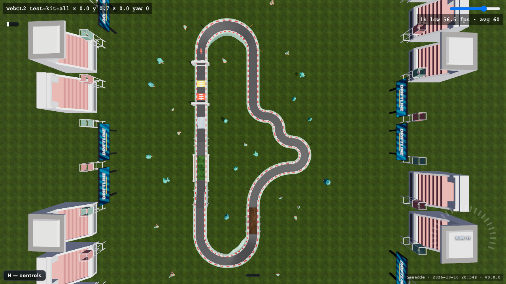

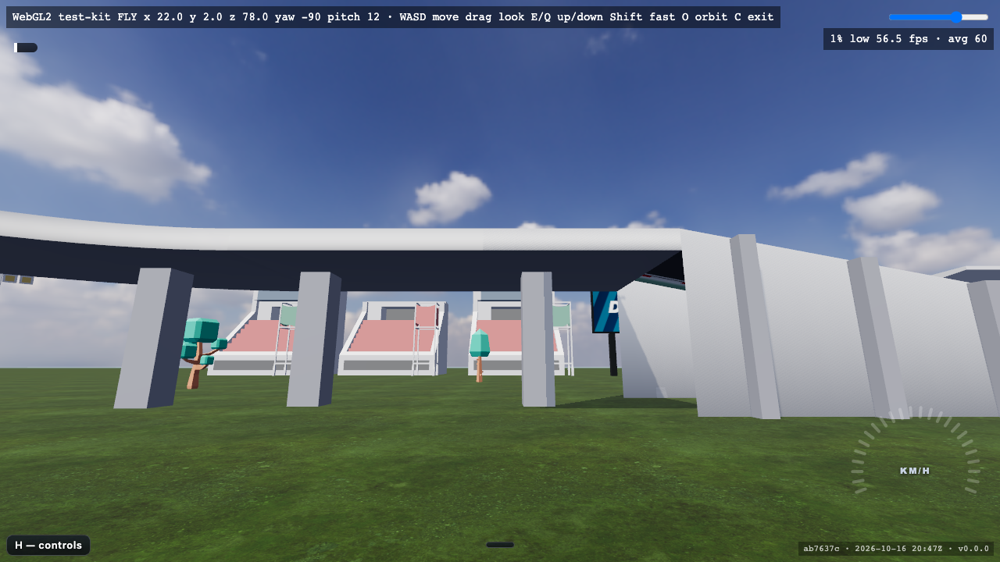

## Catalogue

Screenshots: live site, `?track=test-kit-all&cam=fly&freeze=1&renderer=webgl2` plus the spawn listed per row.

| Piece | Family | Connector | Compiles to | Surfaces | Notes | Spawn | Screenshot |
|---|---|---|---|---|---|---|---|
| `straight-1` | road | (1, 0, 0, 0) | `straight` 10 m | road, dirt, ice, grass | Plain road; on test-kit-all built in ice. | [`x=14&y=11&z=33&yaw=-32.5&pitch=-22.9`](https://bborbe.github.io/driftline/?track=test-kit-all&x=14&y=11&z=33&yaw=-32.5&pitch=-22.9&cam=fly&freeze=1&renderer=webgl2) | 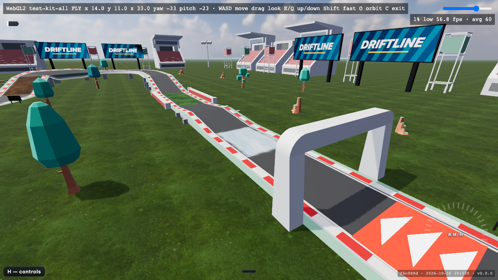 |
| `straight-2` | road | (2, 0, 0, 0) | `straight` 20 m | road, dirt, ice, grass | Here on the 8 m deck: concrete deck box and pillars below. | [`x=14&y=15&z=108&yaw=-32.5&pitch=-22.9`](https://bborbe.github.io/driftline/?track=test-kit-all&x=14&y=15&z=108&yaw=-32.5&pitch=-22.9&cam=fly&freeze=1&renderer=webgl2) | 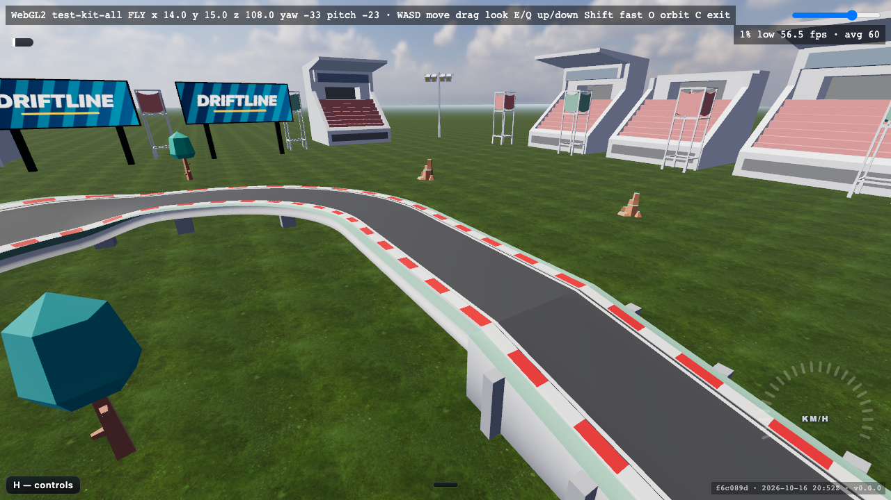 |
| `curve-r1` | curve | (1, ±1, 0, ±1) | `curve` 90°, r 10 m | road | Tightest turn; three in a row make the S-bend. | [`x=84.9&y=11&z=81.1&yaw=-122.5&pitch=-22.9`](https://bborbe.github.io/driftline/?track=test-kit-all&x=84.9&y=11&z=81.1&yaw=-122.5&pitch=-22.9&cam=fly&freeze=1&renderer=webgl2) | 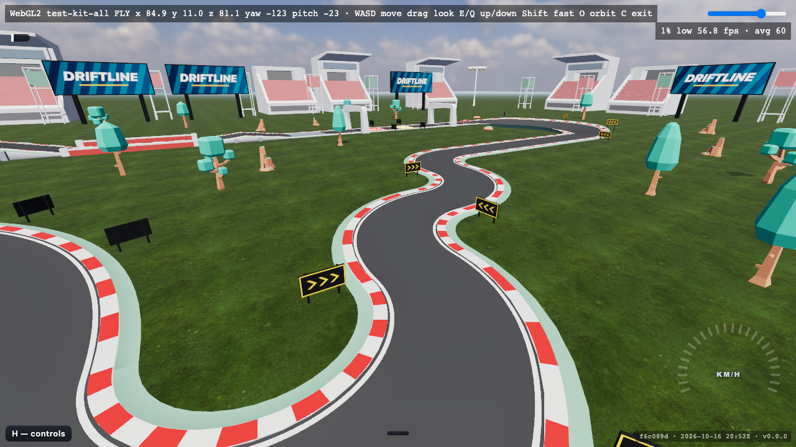 |
| `curve-r2` | curve | (2, ±2, 0, ±1) | `curve` 90°, r 20 m | road | Elevated left turn at the top of the climb. | [`x=19.9&y=15&z=132.1&yaw=-32.5&pitch=-22.9`](https://bborbe.github.io/driftline/?track=test-kit-all&x=19.9&y=15&z=132.1&yaw=-32.5&pitch=-22.9&cam=fly&freeze=1&renderer=webgl2) | 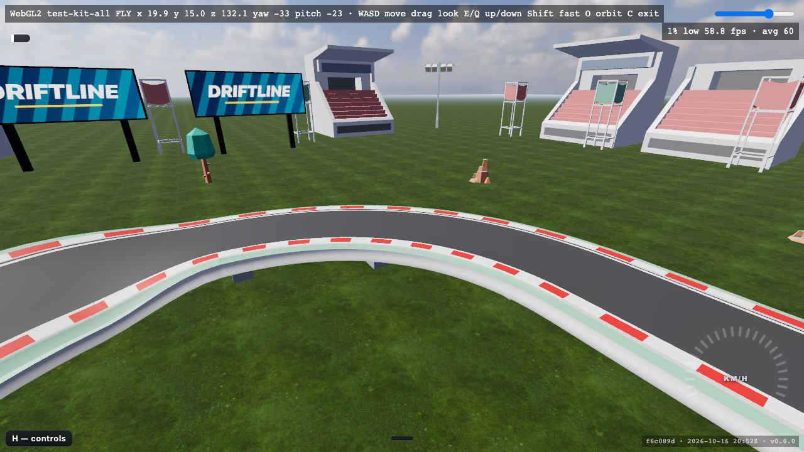 |
| `curve-r3` | curve | (3, ±3, 0, ±1) | `curve` 90°, r 30 m | road | Fast sweeper after the descent. | [`x=34.8&y=11&z=120.8&yaw=147.5&pitch=-22.9`](https://bborbe.github.io/driftline/?track=test-kit-all&x=34.8&y=11&z=120.8&yaw=147.5&pitch=-22.9&cam=fly&freeze=1&renderer=webgl2) | 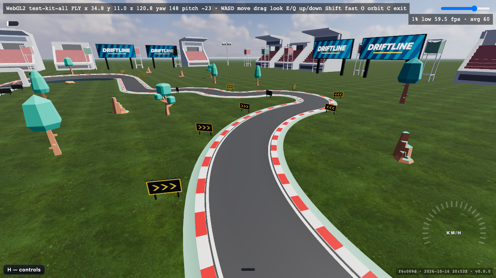 |
| `hairpin` | curve | (0, ±2, 0, ±2) | `hairpin` r 10 m | road | 180° in two lanes; costs speed. | [`x=58&y=11&z=66&yaw=57.5&pitch=-22.9`](https://bborbe.github.io/driftline/?track=test-kit-all&x=58&y=11&z=66&yaw=57.5&pitch=-22.9&cam=fly&freeze=1&renderer=webgl2) | 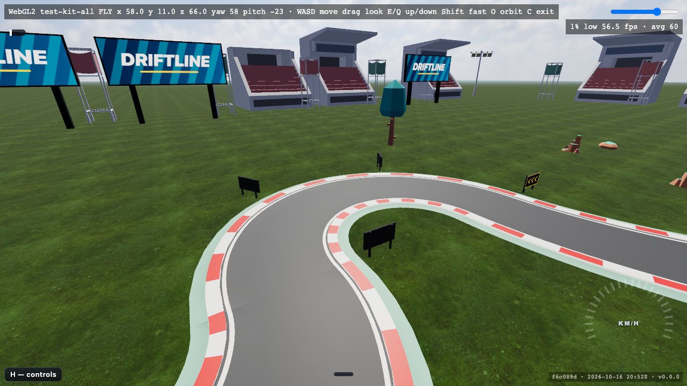 |
| `slope-up` | slope | (2, 0, +1, 0) | `ramp` 20 m, +4 m | road, dirt, ice, grass | One level up (11.3°); walled grass straight in front. | [`x=14&y=13&z=88&yaw=-32.5&pitch=-22.9`](https://bborbe.github.io/driftline/?track=test-kit-all&x=14&y=13&z=88&yaw=-32.5&pitch=-22.9&cam=fly&freeze=1&renderer=webgl2) | 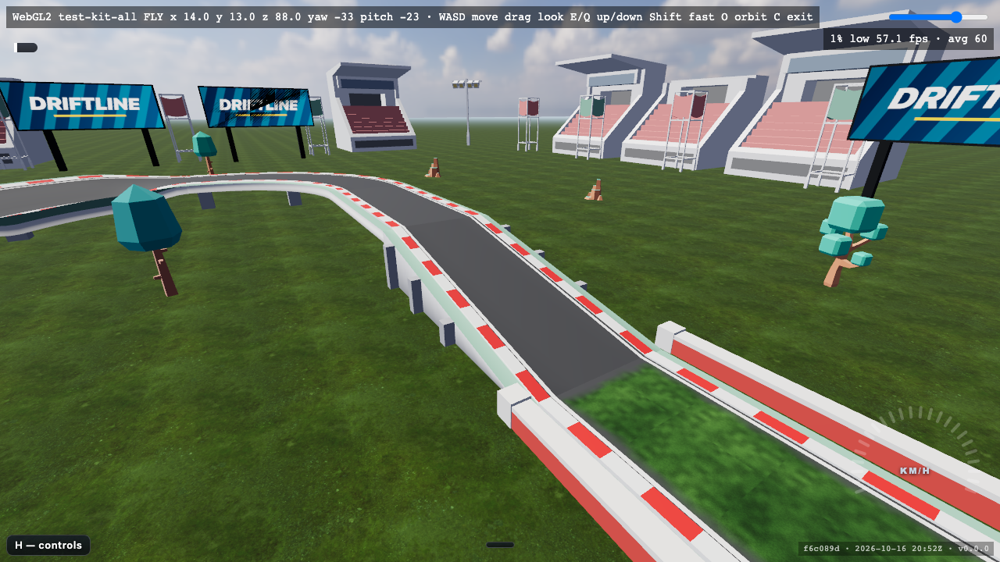 |
| `slope-down` | slope | (2, 0, −1, 0) | `drop` 20 m, −4 m | road, dirt, ice, grass | One level down; here in dirt. | [`x=26&y=13&z=152&yaw=147.5&pitch=-22.9`](https://bborbe.github.io/driftline/?track=test-kit-all&x=26&y=13&z=152&yaw=147.5&pitch=-22.9&cam=fly&freeze=1&renderer=webgl2) | 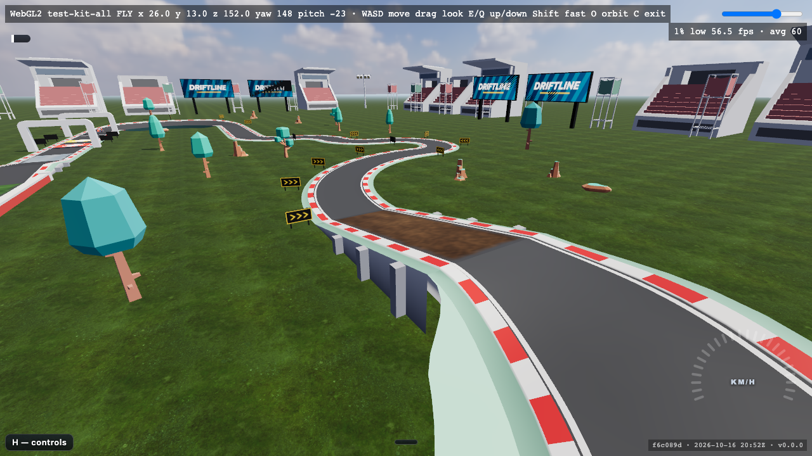 |
| `bump` | slope | (2, 0, 0, 0) | `ramp` 10 m +1 m, `drop` 10 m −1 m | road, dirt, ice, grass | Unloads the suspension at speed. | [`x=14&y=12&z=48&yaw=-32.5&pitch=-22.9`](https://bborbe.github.io/driftline/?track=test-kit-all&x=14&y=12&z=48&yaw=-32.5&pitch=-22.9&cam=fly&freeze=1&renderer=webgl2) | 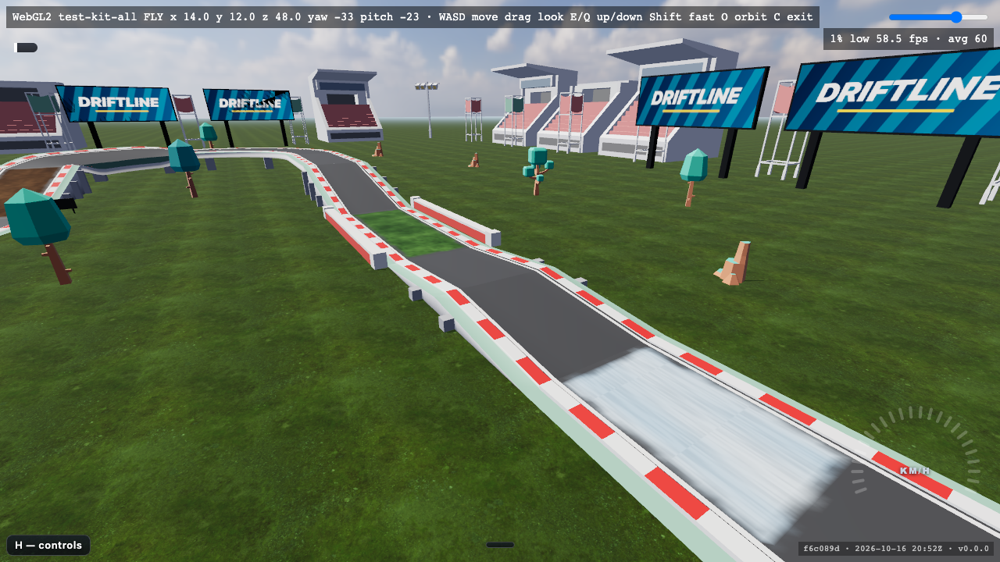 |
| `bank-90` | bank | (2, ±2, 0, ±1) | `banked` 90°, r 20 m, 0.26 rad | road | Bank eases in and out inside the piece, so both connectors are flat. | [`x=12.1&y=15&z=140.1&yaw=57.5&pitch=-22.9`](https://bborbe.github.io/driftline/?track=test-kit-all&x=12.1&y=15&z=140.1&yaw=57.5&pitch=-22.9&cam=fly&freeze=1&renderer=webgl2) | 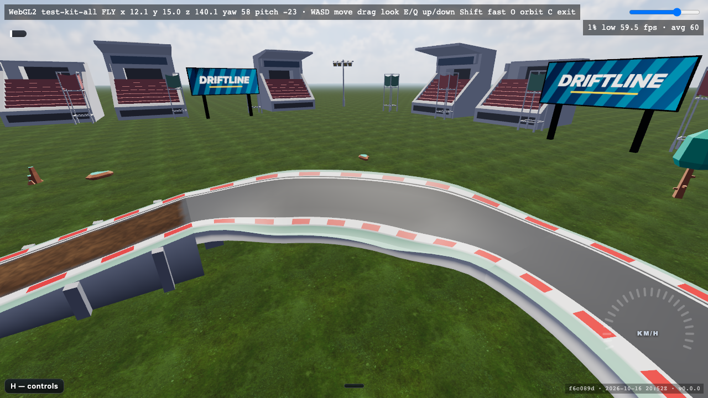 |
| `bank-180` | bank | (0, ±4, 0, ±2) | `banked` 180°, r 20 m, 0.26 rad | road | Closes the lap back onto the start straight. | [`x=6&y=11&z=2&yaw=147.5&pitch=-22.9`](https://bborbe.github.io/driftline/?track=test-kit-all&x=6&y=11&z=2&yaw=147.5&pitch=-22.9&cam=fly&freeze=1&renderer=webgl2) | 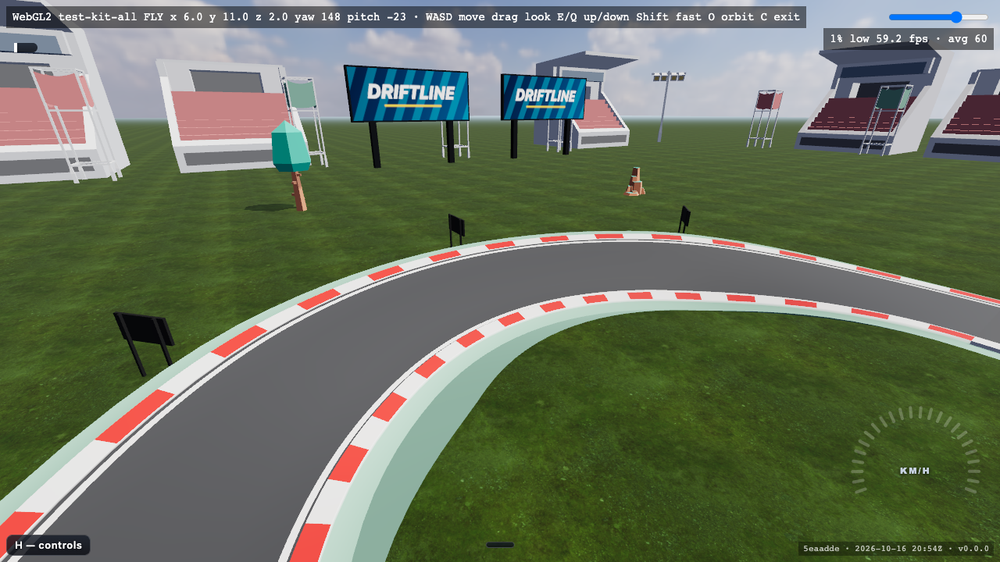 |
| `turbo` | effect | (1, 0, 0, 0) | `straight` 10 m + `turbo` zone 0.25–0.75 | road | Yellow pad; direction from `padForward()`. | [`x=14&y=11&z=3&yaw=-32.5&pitch=-22.9`](https://bborbe.github.io/driftline/?track=test-kit-all&x=14&y=11&z=3&yaw=-32.5&pitch=-22.9&cam=fly&freeze=1&renderer=webgl2) | 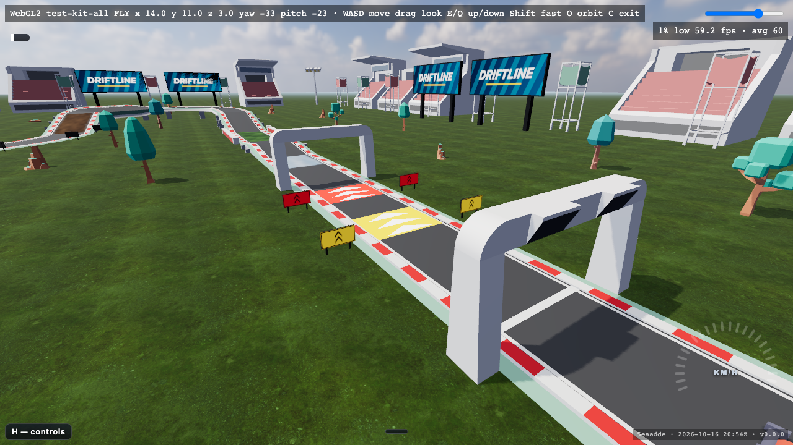 |
| `turbo-red` | effect | (1, 0, 0, 0) | `straight` 10 m + `turbo-red` zone 0.25–0.75 | road | Red pad: stronger boost. | [`x=14&y=11&z=13&yaw=-32.5&pitch=-22.9`](https://bborbe.github.io/driftline/?track=test-kit-all&x=14&y=11&z=13&yaw=-32.5&pitch=-22.9&cam=fly&freeze=1&renderer=webgl2) | 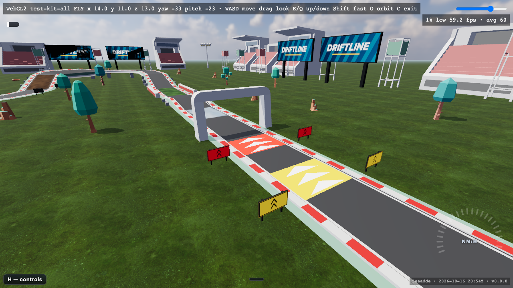 |
| `checkpoint` | gate | (1, 0, 0, 0) | `straight` 10 m + `checkpoint` gate | road | Solid arch pillars; counts only under the arch. | [`x=14&y=11&z=23&yaw=-32.5&pitch=-22.9`](https://bborbe.github.io/driftline/?track=test-kit-all&x=14&y=11&z=23&yaw=-32.5&pitch=-22.9&cam=fly&freeze=1&renderer=webgl2) | 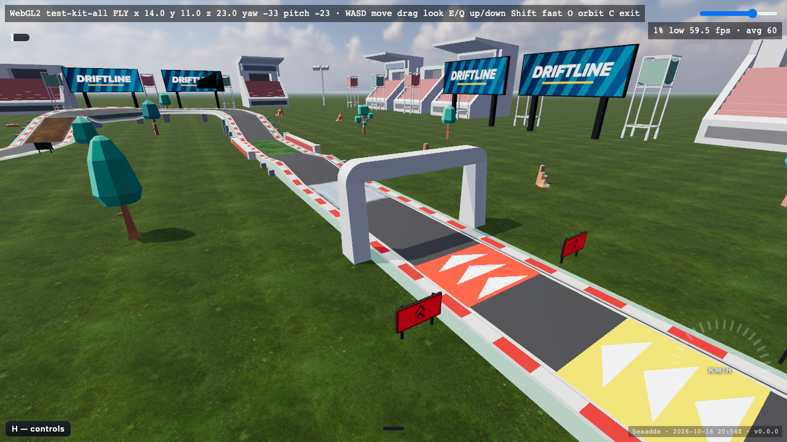 |
| `start` | gate | (2, 0, 0, 0) | `straight` 20 m + `start-finish` gate | road | Arch stands mid-tile; every kit lap starts with it. | [`x=14&y=11&z=-12&yaw=-32.5&pitch=-22.9`](https://bborbe.github.io/driftline/?track=test-kit-all&x=14&y=11&z=-12&yaw=-32.5&pitch=-22.9&cam=fly&freeze=1&renderer=webgl2) | 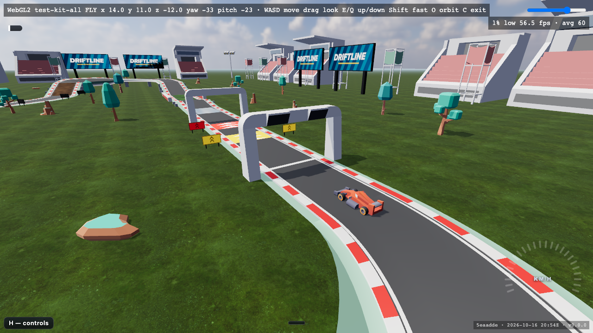 |
| `walled` | wall | (2, 0, 0, 0) | `straight` 20 m + two `barriers` 5.6 m off centre | road, dirt, ice, grass | Ground level only (barriers stand on y = 0); here in grass. | [`x=14&y=11&z=68&yaw=-32.5&pitch=-22.9`](https://bborbe.github.io/driftline/?track=test-kit-all&x=14&y=11&z=68&yaw=-32.5&pitch=-22.9&cam=fly&freeze=1&renderer=webgl2) | 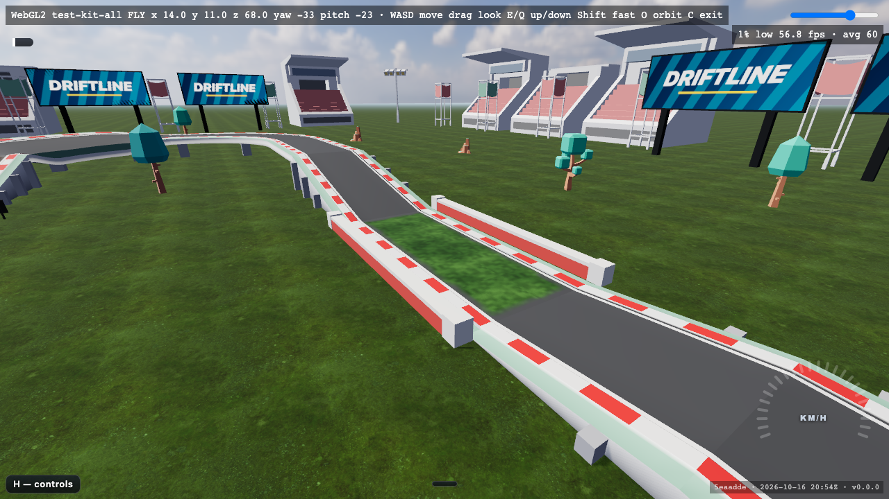 |

## Not in the kit yet

- Jump (ramp + `gap` + landing): the `gap` segment is on master; the piece needs an `air` connector kind.
- Loops, wallrides, pipes, banks over 0.6 rad: need gravity along the surface normal and multi-valued height.
- Walls on elevated road and ceilings: barriers stand on y = 0, and road has no body collision.
