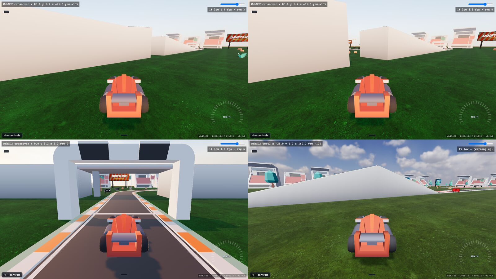
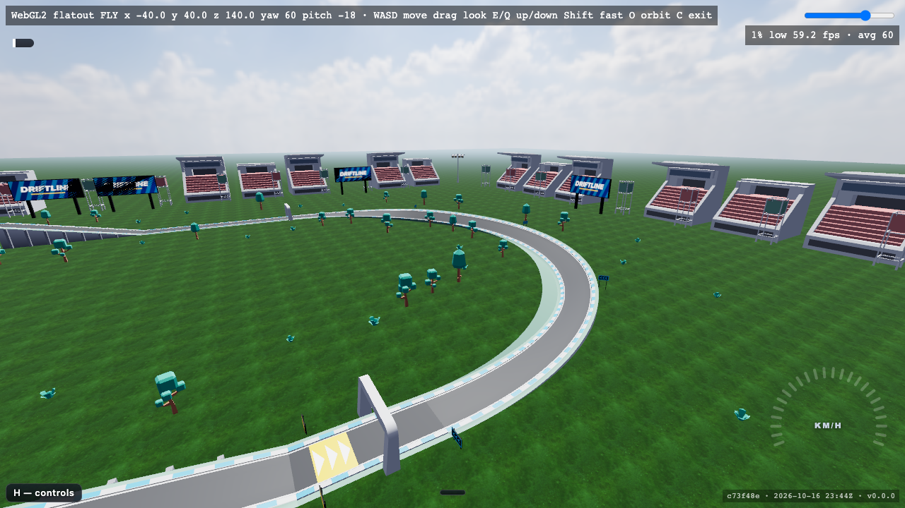
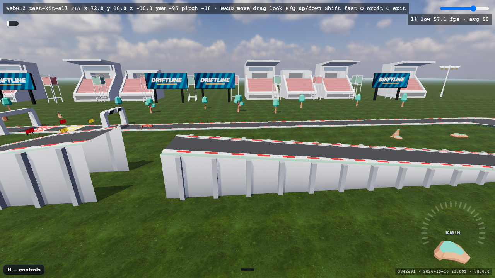
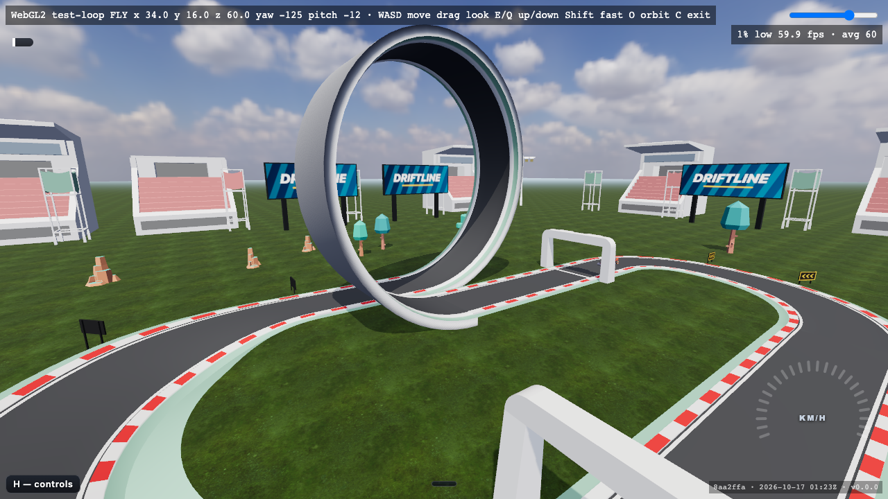

# Track piece kit

Trackmania-style drivable pieces that snap on a grid (`src/track/kit.ts`). A track file with a `kit` block is a list of placed pieces; `resolveTrack()` compiles it to a plain `Track`, so the lap loop, physics, ghost and render need no kit code. Each piece is one definition that expands to schema segments, zones, gates and barriers: the render mesh and the physics collider both come from it.

## Grid and connectors

- `CELL` = 10 m (x, z), `LEVEL` = 4 m (y), headings in quarter turns (0 = +z, counter-clockwise).
- Every connector is flat across (bank 0), kind `road`, 10 m wide.
- Connector = exit relative to entry: (forward cells, left cells, up levels, quarter turns CCW). A right turn mirrors left and turn.
- `kit.test.ts` proves every piece × 4 headings exits where its connector says, all n² piece pairs join with no gap or step across the rendered road (|Δ| < 1e-6), and physics height equals render height on every piece (|Δ| < 1e-3). On the `loop` the road is not a height field, so that check casts along the loop's own normal instead.
- Non-road surfaces are full-length zones. Every road piece comes in dirt, ice and grass: straights, slopes, bump, walled, and curves, hairpin and banks too. The patch follows the arc and the bank roll (`surfacePatch()`, `src/render/track/zones.ts`), and a run of same-surface pieces draws as one patch with no seam at the joins. Pads, gates and `gap-jump` stay road.
- A raised piece (ramp, drop, or road above 5 cm) lower than `BRIDGE_MIN_HEIGHT` (3 m) stands on a solid concrete embankment down to the ground, closed by end caps (`planBodies`, `buildBody`). From 3 m up, and wherever another road passes underneath, it is an open bridge: a closed 1 m concrete deck box with a 0.5 m × 0.8 m parapet along each edge (`buildDeck`), on pillars about every 12 m along each bridge (`planDeckPillars`), open underneath. Where an embankment meets a bridge, its end cap is the abutment. Embankments and pillars collide (`bodyBoxes`, `pillarBoxes` in `src/track/bodies.ts`); the deck and parapets are visual. 

## Writing a kit track

```json
{
  "name": "test-kit",
  "kit": {
    "start": { "cell": [0, 0], "level": 0, "dir": 0 },
    "pieces": [
      { "piece": "start" },
      { "piece": "slope-up" },
      { "piece": "curve-r2", "turn": "left" },
      { "piece": "walled", "surface": "dirt" }
    ]
  }
}
```

The lap must close back onto its start connector; `compileKit()` throws naming the piece otherwise. `test-kit` is the demo, `test-kit-all` uses every piece once except `bank-180-wide`, which is too wide for its compact loop and shows on S02 `flatout`, and the `loop`, which has its own `test-loop` and S06 `looping`. The campaign levels A03 `plunge`, A04 `knot` and A05 `leap` and the style tracks S01–S06 are kit tracks too.

### Walls on any piece

`"walls": "both"` (or `"left"` / `"right"`) on a placement lines that piece with barriers that follow the road — straights, curves, hairpins and banks alike — flush with the road edge. Use it where a cut across the grass pays: dirt and ice slow the road enough that a straight line across the grass (10 m/s cap) beats a winding dirt or ice lap — measured on `dustbowl` and `glacier` before they were walled — and on ice the grass (grip 0.45) even out-grips the road (0.18), so a grass verge inside a wall would still pay. Ground level only, like `walled` (barriers stand on y = 0), and never on a gate (`start`, `checkpoint`: their pillars stand there) or on `walled`; a banked piece gets its inner wall only, because its outer edge rises above a ground-standing wall and running wide off a bank is never a shortcut. S03 `dustbowl` and S04 `glacier` are walled this way.

```json
{ "piece": "bank-90", "turn": "left", "surface": "ice", "walls": "both" }
```


## Catalogue

Screenshots: live site, `?track=test-kit-all&cam=fly&freeze=1&renderer=webgl2` plus the spawn listed per row.

| Piece | Family | Connector | Compiles to | Surfaces | Notes | Spawn | Screenshot |
|---|---|---|---|---|---|---|---|
| `straight-1` | road | (1, 0, 0, 0) | `straight` 10 m | road, dirt, ice, grass | Plain road; on test-kit-all built in ice. | [`x=14&y=11&z=33&yaw=-32.5&pitch=-22.9`](https://bborbe.github.io/driftline/?track=test-kit-all&x=14&y=11&z=33&yaw=-32.5&pitch=-22.9&cam=fly&freeze=1&renderer=webgl2) |  |
| `straight-2` | road | (2, 0, 0, 0) | `straight` 20 m | road, dirt, ice, grass | Here on the 8 m deck: concrete deck box and pillars below. | [`x=14&y=15&z=108&yaw=-32.5&pitch=-22.9`](https://bborbe.github.io/driftline/?track=test-kit-all&x=14&y=15&z=108&yaw=-32.5&pitch=-22.9&cam=fly&freeze=1&renderer=webgl2) |  |
| `curve-r1` | curve | (1, ±1, 0, ±1) | `curve` 90°, r 10 m | road, dirt, ice, grass | Tightest turn; three in a row make the S-bend. | [`x=84.9&y=11&z=81.1&yaw=-122.5&pitch=-22.9`](https://bborbe.github.io/driftline/?track=test-kit-all&x=84.9&y=11&z=81.1&yaw=-122.5&pitch=-22.9&cam=fly&freeze=1&renderer=webgl2) |  |
| `curve-r2` | curve | (2, ±2, 0, ±1) | `curve` 90°, r 20 m | road, dirt, ice, grass | Elevated left turn at the top of the climb. | [`x=19.9&y=15&z=132.1&yaw=-32.5&pitch=-22.9`](https://bborbe.github.io/driftline/?track=test-kit-all&x=19.9&y=15&z=132.1&yaw=-32.5&pitch=-22.9&cam=fly&freeze=1&renderer=webgl2) |  |
| `curve-r3` | curve | (3, ±3, 0, ±1) | `curve` 90°, r 30 m | road, dirt, ice, grass | Fast sweeper after the descent. | [`x=34.8&y=11&z=120.8&yaw=147.5&pitch=-22.9`](https://bborbe.github.io/driftline/?track=test-kit-all&x=34.8&y=11&z=120.8&yaw=147.5&pitch=-22.9&cam=fly&freeze=1&renderer=webgl2) |  |
| `hairpin` | curve | (0, ±2, 0, ±2) | `hairpin` r 10 m | road, dirt, ice, grass | 180° in two lanes; costs speed. | [`x=58&y=11&z=66&yaw=57.5&pitch=-22.9`](https://bborbe.github.io/driftline/?track=test-kit-all&x=58&y=11&z=66&yaw=57.5&pitch=-22.9&cam=fly&freeze=1&renderer=webgl2) |  |
| `slope-up` | slope | (2, 0, +1, 0) | `ramp` 20 m, +4 m | road, dirt, ice, grass | One level up (11.3°); walled grass straight in front. | [`x=14&y=13&z=88&yaw=-32.5&pitch=-22.9`](https://bborbe.github.io/driftline/?track=test-kit-all&x=14&y=13&z=88&yaw=-32.5&pitch=-22.9&cam=fly&freeze=1&renderer=webgl2) |  |
| `slope-down` | slope | (2, 0, −1, 0) | `drop` 20 m, −4 m | road, dirt, ice, grass | One level down; here in dirt. | [`x=26&y=13&z=152&yaw=147.5&pitch=-22.9`](https://bborbe.github.io/driftline/?track=test-kit-all&x=26&y=13&z=152&yaw=147.5&pitch=-22.9&cam=fly&freeze=1&renderer=webgl2) |  |
| `bump` | slope | (2, 0, 0, 0) | `ramp` 10 m +1 m, `drop` 10 m −1 m | road, dirt, ice, grass | Unloads the suspension at speed. | [`x=14&y=12&z=48&yaw=-32.5&pitch=-22.9`](https://bborbe.github.io/driftline/?track=test-kit-all&x=14&y=12&z=48&yaw=-32.5&pitch=-22.9&cam=fly&freeze=1&renderer=webgl2) |  |
| `bank-90` | bank | (2, ±2, 0, ±1) | `banked` 90°, r 20 m, 0.26 rad | road, dirt, ice, grass | Bank eases in and out inside the piece, so both connectors are flat. | [`x=12.1&y=15&z=140.1&yaw=57.5&pitch=-22.9`](https://bborbe.github.io/driftline/?track=test-kit-all&x=12.1&y=15&z=140.1&yaw=57.5&pitch=-22.9&cam=fly&freeze=1&renderer=webgl2) |  |
| `bank-180` | bank | (0, ±4, 0, ±2) | `banked` 180°, r 20 m, 0.26 rad | road, dirt, ice, grass | Closes the lap back onto the start straight. | [`x=6&y=11&z=-118&yaw=147.5&pitch=-22.9`](https://bborbe.github.io/driftline/?track=test-kit-all&x=6&y=11&z=-118&yaw=147.5&pitch=-22.9&cam=fly&freeze=1&renderer=webgl2) |  |
| `bank-180-wide` | bank | (0, ±16, 0, ±2) | `banked` 180°, r 80 m, 0.45 rad | road, dirt, ice, grass | Flat-out 180: holds a full-throttle, no-brake car near its 40 m/s top speed (tighter banks need braking whatever their angle). Too wide for test-kit-all; see S02 `flatout`. | [`track=flatout&x=-40&y=40&z=140&yaw=60&pitch=-18`](https://bborbe.github.io/driftline/?track=flatout&x=-40&y=40&z=140&yaw=60&pitch=-18&cam=fly&freeze=1&renderer=webgl2) |  |
| `gap-jump` | slope | (10, 0, −2, 0) | `ramp` 10 m +1 m, `gap` 10 m −1.8 m, `drop` 80 m −7.2 m | road | crossover's jump on the grid: a 5.7° lip, open air, then a landing slope that continues the line from the lip, long enough for a flat-out flight (`jump-landing.test.ts` on leap). Two levels down. | [`x=72&y=18&z=-30&yaw=-95&pitch=-18`](https://bborbe.github.io/driftline/?track=test-kit-all&x=72&y=18&z=-30&yaw=-95&pitch=-18&cam=fly&freeze=1&renderer=webgl2) |  |
| `loop` | loop | (3, ±1, 0, 0) | `straight` 15 m, `loop` r 15 m, `straight` 15 m | road | A full vertical loop, 30 m tall, with a checkpoint hanging at the top: it holds a full-throttle car from 12.1 m/s at the entry, and a slower one falls off and respawns (§ loop). Its exit is one cell to the turn side. | [`track=test-loop&x=34&y=16&z=60&yaw=-125&pitch=-12`](https://bborbe.github.io/driftline/?track=test-loop&x=34&y=16&z=60&yaw=-125&pitch=-12&cam=fly&freeze=1&renderer=webgl2) |  |
| `turbo` | effect | (1, 0, 0, 0) | `straight` 10 m + `turbo` zone 0.25–0.75 | road | Yellow pad; direction from `padForward()`. | [`x=14&y=11&z=3&yaw=-32.5&pitch=-22.9`](https://bborbe.github.io/driftline/?track=test-kit-all&x=14&y=11&z=3&yaw=-32.5&pitch=-22.9&cam=fly&freeze=1&renderer=webgl2) |  |
| `turbo-red` | effect | (1, 0, 0, 0) | `straight` 10 m + `turbo-red` zone 0.25–0.75 | road | Red pad: stronger boost. | [`x=14&y=11&z=13&yaw=-32.5&pitch=-22.9`](https://bborbe.github.io/driftline/?track=test-kit-all&x=14&y=11&z=13&yaw=-32.5&pitch=-22.9&cam=fly&freeze=1&renderer=webgl2) |  |
| `checkpoint` | gate | (1, 0, 0, 0) | `straight` 10 m + `checkpoint` gate | road | Solid arch pillars; counts only under the arch. | [`x=14&y=11&z=23&yaw=-32.5&pitch=-22.9`](https://bborbe.github.io/driftline/?track=test-kit-all&x=14&y=11&z=23&yaw=-32.5&pitch=-22.9&cam=fly&freeze=1&renderer=webgl2) |  |
| `start` | gate | (2, 0, 0, 0) | `straight` 20 m + `start-finish` gate | road | Arch stands mid-tile; every kit lap starts with it. | [`x=14&y=11&z=-12&yaw=-32.5&pitch=-22.9`](https://bborbe.github.io/driftline/?track=test-kit-all&x=14&y=11&z=-12&yaw=-32.5&pitch=-22.9&cam=fly&freeze=1&renderer=webgl2) |  |
| `walled` | wall | (2, 0, 0, 0) | `straight` 20 m + two `barriers` 5.6 m off centre | road, dirt, ice, grass | Ground level only (barriers stand on y = 0); here in grass. | [`x=14&y=11&z=68&yaw=-32.5&pitch=-22.9`](https://bborbe.github.io/driftline/?track=test-kit-all&x=14&y=11&z=68&yaw=-32.5&pitch=-22.9&cam=fly&freeze=1&renderer=webgl2) |  |

## loop

The loop's road is the inner face of a cylinder of r 15 m (`KIT_LOOP_RADIUS`). Its axis runs across the entry heading, r above the entry. The road is the band of that face that drifts one road width sideways (`LOOP_SHIFT`), eased as θ − sin θ, so it leaves and rejoins the ground running straight ahead. `loopPoint()` in `src/track/pose.ts` is the one shape: physics raycasts the cylinder (`src/physics/surface.ts`), and the mesh and its outer shell sample `loopPoint()`.

- **Real physics.** The wheels cast along the car's own down and gravity stays world −y, so the car stays on only while its speed presses it into the road. Measured with a full-throttle car placed 2 m before the loop at speed v, and bisected on "≥ 3 wheels down everywhere inside, upside down at the top":
  - v_min = 12.1 m/s (43.7 km/h), about √(g·r)
  - it holds from there up to 40 m/s
  - off the throttle it never holds (coast resistance scales with the 2–5 g load)
  - `src/race/loop.test.ts` re-measures v_min and pins 1.1 × and 0.9 ×
- **Too slow falls off.** At 0.9 × v_min the car loses every wheel before the top. 0.3 s with no wheel down inside a loop respawns it at the last checkpoint (`LOOP_FALL_TICKS`, `loopTubes()`).
- **Loop-only physics.**
  - The yaw-stability assist is off while a wheel is on a loop: there its torque about world y rolls the car off the wall.
  - A bump stop takes over past 0.35 m of compression, so the body never sinks through the road at speed.
  - Both are gated on the `loop` flag only loop hits carry, so every other track drives bit-identically (`src/race/golden-replay.test.ts`).
- **Camera.** Inside a loop the chase cam rolls with the car, and the debug overlay adds `up` (−1.00 at the top).
- **Checkpoint at the top.** The exit lane starts beside the foot of the climb, so a lane change there would skip the loop. The piece carries a checkpoint `at: 0.5` of the loop segment: it hangs upside down from the road (`gateUp()` −1), its pillars run down from a clamp over the back of the road, it has no legs (one would stand in the run-in), and the lap counts the car crossing beneath the road. A respawn after it puts the car at rest at the loop's exit, not 30 m up. `src/race/loop-gate.test.ts` proves a lane-change lap does not complete and the autopilot lap still does, on every loop track. Add no other checkpoint on a loop.

## Not in the kit yet

- Wallrides, pipes, banks over 0.6 rad: need gravity along the surface normal and multi-valued height.
- Walls on elevated road and ceilings: barriers stand on y = 0, and road has no body collision.
